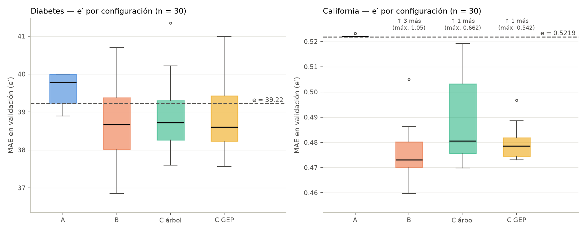
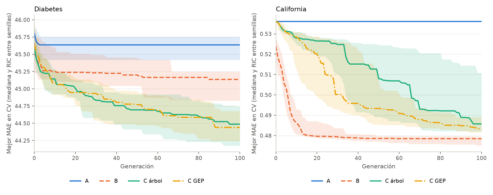
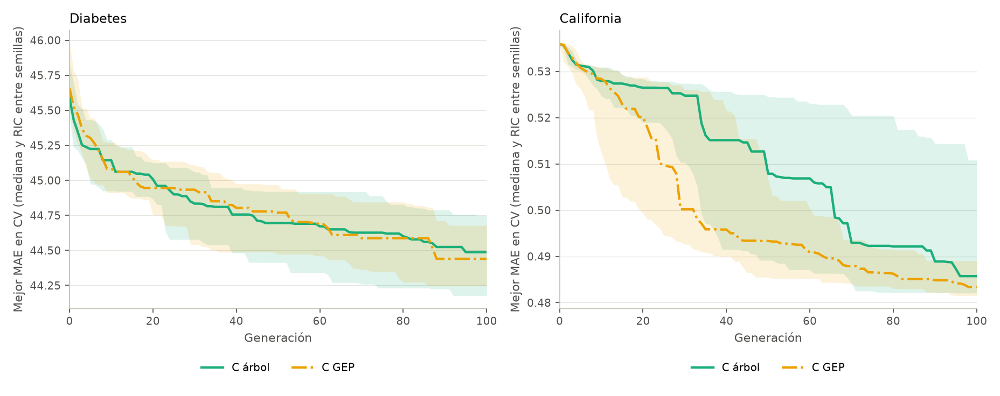
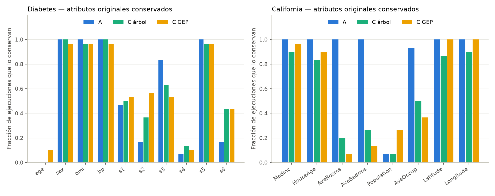

# Resultados

Documento de consulta que reúne todos los resultados del proyecto. **Se genera con `scripts/build_resultados.py`; no se edita a mano.** Cada sección procede de un archivo que ya existía; si cambia alguno, se vuelve a ejecutar el script.

| Sección | Qué contiene | Fuente | Momento |
| --- | --- | --- | --- |
| 1. Resumen | Contraste de H1–H5 y tabla e / e′ | `results/analysis/estadistica.json` | validación |
| 2. Piloto | Rejilla K × profundidad, ε y comprobación de ε > 0 | `results/pilot/` | solo train |
| 3. Hipótesis | H1–H5 tal como se escribieron antes de lanzar los experimentos | `docs/HIPOTESIS.md` | antes de validación |
| 4. Experimentos finales | Tablas, tests estadísticos, modelos secundarios, fórmulas y figuras | `results/analysis/` | validación |
| 5. Posterior a la validación | D23, diagnóstico de la cola de California e interpretación de H2 | `results/d23/`, `results/diagnostics/`, `docs/INTERPRETACION.md` | después de ver la validación |
| 5.4 Exploratorio | Tasa de mutación de los árboles (solo train) | `results/explore_mutation/`, `docs/EXPLORATORIO.md` | después de ver la validación |

Los análisis de la sección 5 se hicieron después de ver los resultados de validación, sin cambiar el código del sistema ni ningún parámetro; se informan salgan como salgan (`docs/DISENO.md`, D23).

## 1. Resumen

Contraste de las hipótesis de `docs/HIPOTESIS.md` con los experimentos finales (30 semillas por celda, evaluados en validación):

- **H1** — En California, C mejora claramente (e′ < e). → **apoyada**. mejora relativa mediana 7.92 %, Wilcoxon unilateral p = 1.9e-06.
- **H2** — En Diabetes, la mejora es pequeña o nula. → **interpretación manual**. mejora relativa mediana 1.28 %, Wilcoxon unilateral p = 0.0053; el diseño no fija un umbral para «pequeña»: interpretación manual.
- **H3** — B aporta más que A en ambos datasets. → **apoyada**. California: mediana e′ B = 0.4731, A = 0.5219, p = 1.03e-08; Diabetes: mediana e′ B = 38.67, A = 39.78, p = 0.000863.
- **H4** — Sin diferencia significativa en e′ entre árboles y GEP; si la hay, en la velocidad de convergencia. → **apoyada**. California: e′ árbol = 0.4806, GEP = 0.4786, p = 0.137; gen90 árbol = 59, GEP = 61, p = 0.796; Diabetes: e′ árbol = 38.72, GEP = 38.61, p = 0.912; gen90 árbol = 71, GEP = 68, p = 0.371. (no rechazar la igualdad no prueba que sea cierta)
- **H5** — En California, B obtiene un e′ menor que C (coste de exigir s < n). → **apoyada**. mediana e′ B = 0.4731, C = 0.4806 (coste +0.007495), p = 0.000476; C usa n − 1 = 7 columnas en el 100 % de las ejecuciones.

**Conclusión de H2 tras D23 (posterior a la validación, manual):** ver la sección 5.3. La mejora de Diabetes en la partición 2026 no se reproduce en otras particiones.

**H4 tras los análisis posteriores (5.2 y 5.4):** misma mediana de e′, pero los árboles fallan más (11/30 ejecuciones malas en California, fallo de búsqueda); con más mutación la cola casi desaparece (descriptivo, no significativo). La diferencia de fiabilidad se atribuye probablemente a la intensidad de mutación, no a la representación.

Resumen de e frente a e′ (mediana de e′ sobre las 30 semillas):

| Dataset | Configuración | e | mediana e′ | % e′ < e | mejora rel. mediana |
| --- | --- | --- | --- | --- | --- |
| California | Línea base | 0.5219 | 0.5219 | 0 | -0.00 % |
| California | A (selección) | 0.5219 | 0.5219 | 0 | -0.01 % |
| California | B (síntesis) | 0.5219 | 0.4731 | 90 | 9.35 % |
| California | C (árbol) | 0.5219 | 0.4806 | 97 | 7.92 % |
| California | C (GEP) | 0.5219 | 0.4786 | 97 | 8.30 % |
| Diabetes | Línea base | 39.22 | 39.22 | 0 | 0.00 % |
| Diabetes | A (selección) | 39.22 | 39.78 | 13 | -1.43 % |
| Diabetes | B (síntesis) | 39.22 | 38.67 | 67 | 1.41 % |
| Diabetes | C (árbol) | 39.22 | 38.72 | 73 | 1.28 % |
| Diabetes | C (GEP) | 39.22 | 38.61 | 67 | 1.57 % |

## 2. Piloto (hito 8, solo train)

### Diabetes

Piloto D20 — diabetes (configuración C, árboles; MAE en CV repetida con folds nuevos)

| K | prof. | MAE CV (media ± sd) | vs baseline | complejidad | columnas | tiempo (s) | eval. distintas |
| --- | --- | --- | --- | --- | --- | --- | --- |
| 3 | 2 | 44.2894 ± 0.2919 | +3.9 % | 20.3 | 8.7 | 68 | 6128 |
| 3 | 3 | 43.7367 ± 0.5432 | +5.1 % | 25.3 | 8.3 | 75 | 6914 |
| 3 | 4 | 43.9118 ± 0.8908 | +4.7 % | 29.7 | 7.7 | 81 | 7398 |
| 5 | 2 | 44.0031 ± 0.4020 | +4.5 % | 26.3 | 8.7 | 72 | 6603 |
| 5 | 3 | 43.5737 ± 0.0989 | +5.4 % | 38.7 | 8.0 | 87 | 7647 |
| 5 | 4 | 43.7407 ± 0.1957 | +5.1 % | 45.3 | 8.7 | 76 | 7347 |
| 7 | 2 | 44.3310 ± 0.3019 | +3.8 % | 26.3 | 8.7 | 68 | 6249 |
| 7 | 3 | 43.2266 ± 0.6477 | +6.2 % | 43.7 | 9.0 | 64 | 7343 |
| 7 | 4 | 44.3207 ± 0.4639 | +3.8 % | 34.3 | 9.0 | 48 | 6867 |

Baseline (OLS, todos los originales) en CV con los mismos folds: 46.0725 (por semilla: 46.2285, 46.0462, 45.9428); el mejor C mejora un 6.2 %

ε propuesto (mediana de std de los 5 folds / √5): 1.2601 (rango por ejecución 0.4721 – 2.2115)
Mejor MAE medio en CV: K = 7, profundidad = 3
Dentro de ε del mejor: (K=3, d=2), (K=3, d=3), (K=3, d=4), (K=5, d=2), (K=5, d=3), (K=5, d=4), (K=7, d=2), (K=7, d=3), (K=7, d=4)
Propuesta de este dataset (menor K y, a igualdad, menor profundidad): K = 3, profundidad = 2

### California

Piloto D20 — california (configuración C, árboles; MAE en CV repetida con folds nuevos)

| K | prof. | MAE CV (media ± sd) | vs baseline | complejidad | columnas | tiempo (s) | eval. distintas |
| --- | --- | --- | --- | --- | --- | --- | --- |
| 3 | 2 | 0.4948 ± 0.0240 | +7.7 % | 17.0 | 7.0 | 251 | 5031 |
| 3 | 3 | 0.4823 ± 0.0035 | +10.0 % | 19.7 | 7.0 | 290 | 5823 |
| 3 | 4 | 0.4959 ± 0.0231 | +7.5 % | 20.7 | 6.7 | 263 | 5424 |
| 5 | 2 | 0.5014 ± 0.0193 | +6.5 % | 19.3 | 7.0 | 303 | 6091 |
| 5 | 3 | 0.4888 ± 0.0087 | +8.8 % | 25.0 | 7.0 | 306 | 6135 |
| 5 | 4 | 0.5011 ± 0.0241 | +6.5 % | 30.7 | 7.0 | 310 | 6432 |
| 7 | 2 | 0.4934 ± 0.0185 | +8.0 % | 17.0 | 7.0 | 283 | 5567 |
| 7 | 3 | 0.4804 ± 0.0012 | +10.4 % | 24.0 | 7.0 | 220 | 5791 |
| 7 | 4 | 0.4872 ± 0.0042 | +9.1 % | 21.3 | 7.0 | 183 | 6169 |

Baseline (OLS, todos los originales) en CV con los mismos folds: 0.5362 (por semilla: 0.5361, 0.5360, 0.5364); el mejor C mejora un 10.4 %

ε propuesto (mediana de std de los 5 folds / √5): 0.0030 (rango por ejecución 0.0017 – 0.0046)
Mejor MAE medio en CV: K = 7, profundidad = 3
Dentro de ε del mejor: (K=3, d=3), (K=7, d=3)
Propuesta de este dataset (menor K y, a igualdad, menor profundidad): K = 3, profundidad = 3

### Comprobación de ε > 0 (hito 8b)

Comprobación 8b — diabetes (C, K = 3, profundidad = 3, semillas [100, 101, 102])

| ε | MAE CV | vs baseline | complejidad | columnas | tiempo (s) | eval. distintas |
| --- | --- | --- | --- | --- | --- | --- |
| 0 | 43.7367 | +5.1 % | 25.3 | 8.3 | 75 | 6914 |
| 1.26 | 44.4295 | +3.6 % | 21.3 | 8.0 | 18 | 3991 |

Baseline (OLS, todos los originales) en CV: 46.0725
MAE CV por semilla con ε = 0: 43.5143, 44.3558, 43.3400
MAE CV por semilla con ε final: 43.6585, 44.8794, 44.7504
Diferencia (ε final − ε = 0): +0.6928 (umbral ε = 1.26)
CRITERIO: no empeora más de ε -> se puede seguir

Comprobación 8b — california (C, K = 3, profundidad = 3, semillas [100, 101, 102])

| ε | MAE CV | vs baseline | complejidad | columnas | tiempo (s) | eval. distintas |
| --- | --- | --- | --- | --- | --- | --- |
| 0 | 0.4823 | +10.0 % | 19.7 | 7.0 | 290 | 5823 |
| 0.003 | 0.4852 | +9.5 % | 18.3 | 7.0 | 125 | 5012 |

Baseline (OLS, todos los originales) en CV: 0.5362
MAE CV por semilla con ε = 0: 0.4796, 0.4862, 0.4812
MAE CV por semilla con ε final: 0.4811, 0.4818, 0.4927
Diferencia (ε final − ε = 0): +0.0029 (umbral ε = 0.003)
CRITERIO: no empeora más de ε -> se puede seguir

**Decisión tras el piloto** (ver `docs/DISENO.md`, D20): K = 3 y profundidad 3 en ambos datasets (GEP: h = 7); ε = 1,26 en Diabetes y 0,0030 en California.

## 3. Hipótesis (escritas antes de lanzar los experimentos)

Fecha de redacción: **2026-11-16**. Este archivo se escribe y se commitea antes de lanzar el
hito 9 (experimentos finales). No se edita después de ver resultados finales.

H1–H4 son las del diseño (`docs/DISENO.md`, D21 y D25) y se formularon antes de ejecutar nada.
H5 se formula **después del piloto y solo con train**, y así se marca.

### Hipótesis del diseño (antes de ejecutar)

- **H1.** En California, C mejora claramente (e′ < e), porque sus relaciones son no lineales.
- **H2.** En Diabetes, la mejora es pequeña o nula, porque la relación es casi lineal, hay pocas
  filas y la validación es ruidosa.
- **H3.** B aporta más que A en ambos datasets (crear atributos aporta más que quitarlos).
- **H4.** No habrá diferencia significativa en e′ entre árboles y GEP (configuración C, mismo
  tamaño máximo de fórmula), porque con el mismo tamaño máximo ambas pueden expresar
  prácticamente las mismas fórmulas; si hay diferencias, aparecerán en la velocidad de
  convergencia.

### Hipótesis formulada tras el piloto (solo con train)

- **H5 (formulada tras el piloto, solo con train).** En California la restricción de D24 está
  activa: en 26 de las 27 ejecuciones del piloto (y en las 3 con K = 3 y profundidad 3) los
  individuos finales usan n − 1 = 7 columnas; la restante usa 6. Se espera que B (todos los
  originales más síntesis, sin límite de columnas) obtenga un e′ menor que C, y que la
  diferencia mida el coste de exigir s < n.

### Contexto del piloto disponible antes de ejecutar (solo train, MAE en CV repetida con folds nuevos)

Se anota para que quede constancia de lo que se sabía al fijar las hipótesis; no modifica H1–H4.

| Dataset | Baseline (OLS, todos los originales) | C con K = 3, profundidad 3 (ε = 0) | Mejora relativa en CV |
| --- | --- | --- | --- |
| California | 0,5362 | 0,4823 | 10,0 % |
| Diabetes | 46,07 | 43,74 | 5,1 % |

- Con el ε final (Diabetes 1,26, California 0,0030) el MAE en CV pasa a 0,4852 (+0,0029; la mejora
  baja a 9,5 %) en California y a 44,43 (+0,69; la mejora baja a 3,6 %) en Diabetes. En ninguno
  de los dos empeora más de ε, así que se sigue adelante con los ε finales.
- La mejora en CV de Diabetes (≈ 5 %) es mayor que la que sugiere H2. H2 se mantiene tal como se
  escribió: la CV interna no es la validación, y la validación de Diabetes tiene solo 88 filas.
- Parámetros fijados por el piloto (D20): K = 3 y profundidad máxima 3 para ambos datasets
  (GEP: h = 7); ε por dataset: Diabetes 1,26 y California 0,0030.

## 4. Experimentos finales (validación)

### e frente a e′ por dataset y configuración

| Dataset | Configuración | n | e | mediana e′ | Q1 | Q3 | RIC | % e′ < e | mejora rel. mediana | columnas | sintetizadas | MAE CV mediana | e′ − MAE CV | tiempo (s) | eval. distintas |
| --- | --- | --- | --- | --- | --- | --- | --- | --- | --- | --- | --- | --- | --- | --- | --- |
| California | Línea base | 30 | 0.5219 | 0.5219 | 0.5219 | 0.5219 | 0 | 0 | -0.00 % | 8 | 0 | 0.5363 | -0.01445 | 31 | 0 |
| California | A (selección) | 30 | 0.5219 | 0.5219 | 0.5219 | 0.5219 | 0 | 0 | -0.01 % | 7 | 0 | 0.5363 | -0.01437 | 34 | 202 |
| California | B (síntesis) | 30 | 0.5219 | 0.4731 | 0.4701 | 0.4802 | 0.01012 | 90 | 9.35 % | 11 | 3 | 0.4785 | -0.004828 | 98 | 1535 |
| California | C (árbol) | 30 | 0.5219 | 0.4806 | 0.4755 | 0.5032 | 0.02766 | 97 | 7.92 % | 7 | 3 | 0.4855 | -0.006344 | 144 | 4634 |
| California | C (GEP) | 30 | 0.5219 | 0.4786 | 0.4744 | 0.4818 | 0.007436 | 97 | 8.30 % | 7 | 2 | 0.4834 | -0.006334 | 193 | 6567 |
| Diabetes | Línea base | 30 | 39.22 | 39.22 | 39.22 | 39.22 | 0 | 0 | 0.00 % | 10 | 0 | 46.22 | -6.997 | 1 | 0 |
| Diabetes | A (selección) | 30 | 39.22 | 39.78 | 39.24 | 40 | 0.759 | 13 | -1.43 % | 6 | 0 | 45.76 | -6.109 | 4 | 538 |
| Diabetes | B (síntesis) | 30 | 39.22 | 38.67 | 38.01 | 39.37 | 1.359 | 67 | 1.41 % | 12 | 2 | 45.3 | -6.375 | 8 | 1198 |
| Diabetes | C (árbol) | 30 | 39.22 | 38.72 | 38.26 | 39.3 | 1.037 | 73 | 1.28 % | 8 | 2 | 44.78 | -5.849 | 23 | 3592 |
| Diabetes | C (GEP) | 30 | 39.22 | 38.61 | 38.23 | 39.43 | 1.201 | 67 | 1.57 % | 8 | 2 | 44.7 | -5.889 | 24 | 3800 |

### Pruebas estadísticas

Nivel de significación α = 0.05. Los p-valores no se corrigen entre hipótesis distintas.

#### Wilcoxon de una muestra sobre e′ − e (unilateral: e′ < e)

| Dataset | Configuración | mediana e′ − e | mejora rel. mediana | p | significativo |
| --- | --- | --- | --- | --- | --- |
| California | A (selección) | 4.705e-05 | -0.01 % | 1 | no |
| California | B (síntesis) | -0.0488 | 9.35 % | 0.00021 | sí |
| California | C (árbol) | -0.04131 | 7.92 % | 1.9e-06 | sí |
| California | C (GEP) | -0.04331 | 8.30 % | 9.6e-07 | sí |
| Diabetes | A (selección) | 0.5624 | -1.43 % | 1 | no |
| Diabetes | B (síntesis) | -0.5513 | 1.41 % | 0.0202 | sí |
| Diabetes | C (árbol) | -0.5027 | 1.28 % | 0.0053 | sí |
| Diabetes | C (GEP) | -0.6162 | 1.57 % | 0.046 | sí |

#### Kruskal-Wallis entre A, B y C (árbol) sobre e′, y Mann-Whitney por pares con Holm

| Dataset | Contraste | medianas / estadístico | p crudo | p (Holm) |  | significativo |
| --- | --- | --- | --- | --- | --- | --- |
| California | Kruskal-Wallis | H = 49.7 |  | 1.58e-11 |  | sí |
| California | Mann-Whitney A-B | 0.5219 vs 0.4731 | 2.05e-08 | 4.11e-08 |  | sí |
| California | Mann-Whitney A-C | 0.5219 vs 0.4806 | 6.02e-11 | 1.81e-10 |  | sí |
| California | Mann-Whitney B-C | 0.4731 vs 0.4806 | 0.000952 | 0.000952 |  | sí |
| Diabetes | Kruskal-Wallis | H = 18.6 |  | 9.32e-05 |  | sí |
| Diabetes | Mann-Whitney A-B | 39.78 vs 38.67 | 0.00173 | 0.00345 |  | sí |
| Diabetes | Mann-Whitney A-C | 39.78 vs 38.72 | 1.63e-05 | 4.9e-05 |  | sí |
| Diabetes | Mann-Whitney B-C | 38.67 vs 38.72 | 0.912 | 0.912 |  | no |

Los pares solo son interpretables si Kruskal-Wallis es significativo (D22).

#### H3: B frente a A (unilateral: e′ de B < e′ de A)

| Dataset | mediana e′ B | mediana e′ A | p | significativo |
| --- | --- | --- | --- | --- |
| California | 0.4731 | 0.5219 | 1.03e-08 | sí |
| Diabetes | 38.67 | 39.78 | 0.000863 | sí |

#### H4 (D25): C con árboles frente a C con GEP (bilateral)

| Dataset | medida | mediana árbol | mediana GEP | p | significativo |
| --- | --- | --- | --- | --- | --- |
| California | e′ | 0.4806 | 0.4786 | 0.137 | no |
| California | columnas | 7 | 7 | 0.334 | no |
| California | nodos de fórmula (total) | 10 | 10.5 | 0.894 | no |
| California | generación al 90 % de la mejora | 59 | 61 | 0.796 | no |
| California | tiempo (s) | 144.1 | 192.8 | 6.07e-11 | sí |
| California | evaluaciones distintas | 4634 | 6567 | 7.38e-11 | sí |
| Diabetes | e′ | 38.72 | 38.61 | 0.912 | no |
| Diabetes | columnas | 8 | 8 | 0.676 | no |
| Diabetes | nodos de fórmula (total) | 10.5 | 10.5 | 0.494 | no |
| Diabetes | generación al 90 % de la mejora | 71 | 68.5 | 0.371 | no |
| Diabetes | tiempo (s) | 22.6 | 23.96 | 0.0103 | sí |
| Diabetes | evaluaciones distintas | 3592 | 3800 | 0.126 | no |

#### H5: B frente a C en California (unilateral: e′ de B < e′ de C)

| Dataset | mediana e′ B | mediana e′ C | coste de s < n (C − B) | p | C usa n − 1 columnas | significativo |
| --- | --- | --- | --- | --- | --- | --- |
| California | 0.4731 | 0.4806 | +0.007495 | 0.000476 | 100 % | sí |
| Diabetes | 38.67 | 38.72 | +0.04862 | 0.456 | 43 % | no |

### Modelos secundarios (D11)

| Dataset | Configuración | Modelo | mediana e | mediana e′ | Q1 | Q3 | % e′ < e | mejora rel. mediana | p (Wilcoxon) |
| --- | --- | --- | --- | --- | --- | --- | --- | --- | --- |
| California | A (selección) | Ridge | 0.5219 | 0.5219 | 0.5219 | 0.5219 | 0 | -0.01 % | 1 |
| California | A (selección) | KNN | 0.426 | 0.3963 | 0.3963 | 0.3963 | 93 | 6.98 % | 3.55e-05 |
| California | A (selección) | Random Forest | 0.3303 | 0.3282 | 0.3277 | 0.3287 | 100 | 0.60 % | 9.31e-10 |
| California | B (síntesis) | Ridge | 0.5219 | 0.473 | 0.4699 | 0.48 | 90 | 9.36 % | 0.00021 |
| California | B (síntesis) | KNN | 0.426 | 0.4357 | 0.4183 | 0.442 | 43 | -2.26 % | 0.971 |
| California | B (síntesis) | Random Forest | 0.3303 | 0.3326 | 0.3312 | 0.3339 | 20 | -0.78 % | 0.987 |
| California | C (árbol) | Ridge | 0.5219 | 0.4806 | 0.4755 | 0.5032 | 97 | 7.92 % | 1.9e-06 |
| California | C (árbol) | KNN | 0.426 | 0.4129 | 0.4025 | 0.4197 | 80 | 3.09 % | 0.000643 |
| California | C (árbol) | Random Forest | 0.3303 | 0.3298 | 0.3273 | 0.3316 | 57 | 0.26 % | 0.452 |
| California | C (GEP) | Ridge | 0.5219 | 0.4786 | 0.4744 | 0.4818 | 97 | 8.30 % | 9.6e-07 |
| California | C (GEP) | KNN | 0.426 | 0.4156 | 0.409 | 0.4208 | 90 | 2.45 % | 7.46e-06 |
| California | C (GEP) | Random Forest | 0.3303 | 0.3291 | 0.328 | 0.3309 | 63 | 0.45 % | 0.103 |
| Diabetes | A (selección) | Ridge | 39.36 | 39.8 | 39.26 | 40 | 30 | -1.11 % | 1 |
| Diabetes | A (selección) | KNN | 39.95 | 38.89 | 36.7 | 39.89 | 83 | 2.66 % | 0.000353 |
| Diabetes | A (selección) | Random Forest | 40.96 | 41.43 | 41.04 | 41.69 | 17 | -0.98 % | 0.988 |
| Diabetes | B (síntesis) | Ridge | 39.36 | 38.79 | 38.35 | 39.55 | 67 | 1.45 % | 0.0202 |
| Diabetes | B (síntesis) | KNN | 39.95 | 40.53 | 39.93 | 41.57 | 27 | -1.44 % | 0.999 |
| Diabetes | B (síntesis) | Random Forest | 40.96 | 41.2 | 40.87 | 41.65 | 20 | -0.71 % | 0.999 |
| Diabetes | C (árbol) | Ridge | 39.36 | 38.75 | 38.39 | 39.31 | 77 | 1.56 % | 0.00109 |
| Diabetes | C (árbol) | KNN | 39.95 | 41.9 | 39.77 | 44.39 | 27 | -4.86 % | 1 |
| Diabetes | C (árbol) | Random Forest | 40.96 | 41.75 | 41.25 | 42.31 | 23 | -1.96 % | 1 |
| Diabetes | C (GEP) | Ridge | 39.36 | 38.62 | 38.33 | 39.4 | 73 | 1.89 % | 0.0139 |
| Diabetes | C (GEP) | KNN | 39.95 | 41.96 | 41.01 | 43.34 | 20 | -5.03 % | 1 |
| Diabetes | C (GEP) | Random Forest | 40.96 | 41.41 | 40.73 | 42.23 | 27 | -1.31 % | 0.993 |

### Fórmulas y atributos

#### California

Fracción de ejecuciones que conservan cada atributo original (los que menos aparecen son los más eliminados); B conserva todos por construcción:

| Atributo | A | C árbol | C GEP |
| --- | --- | --- | --- |
| MedInc | 1.00 | 0.90 | 0.97 |
| HouseAge | 1.00 | 0.83 | 0.90 |
| AveRooms | 1.00 | 0.20 | 0.07 |
| AveBedrms | 1.00 | 0.27 | 0.13 |
| Population | 0.07 | 0.07 | 0.27 |
| AveOccup | 0.93 | 0.50 | 0.37 |
| Latitude | 1.00 | 0.87 | 1.00 |
| Longitude | 1.00 | 0.90 | 1.00 |

Fracción de ejecuciones cuyas fórmulas usan cada atributo original:

| Atributo | B | C árbol | C GEP |
| --- | --- | --- | --- |
| MedInc | 0.03 | 0.23 | 0.07 |
| HouseAge | 0.10 | 0.20 | 0.17 |
| AveRooms | 0.90 | 0.80 | 0.80 |
| AveBedrms | 0.27 | 0.20 | 0.10 |
| Population | 0.07 | 0.10 | 0.03 |
| AveOccup | 1.00 | 0.87 | 1.00 |
| Latitude | 0.30 | 0.43 | 0.23 |
| Longitude | 0.23 | 0.30 | 0.10 |

Operadores en las fórmulas finales (recuento total):

| Operador | B | C árbol | C GEP |
| --- | --- | --- | --- |
| add | 20 | 35 | 21 |
| sub | 14 | 24 | 24 |
| mul | 38 | 17 | 11 |
| div | 4 | 8 | 11 |
| sqrt | 52 | 42 | 42 |
| log | 80 | 56 | 92 |

Tamaño de las fórmulas y diversidad:

| Configuración | fórmulas | distintas | nodos (mediana) | nodos (máx.) |
| --- | --- | --- | --- | --- |
| B | 90 | 44 | 4 | 13 |
| C árbol | 74 | 56 | 5 | 12 |
| C GEP | 68 | 44 | 5 | 11 |

Fórmulas más frecuentes — B (síntesis):

- (18×) `log(1 + |AveRooms|)`
- (9×) `log(1 + |AveOccup|)`
- (8×) `sqrt(|(AveOccup * AveOccup)|)`
- (7×) `(sqrt(|AveOccup|) * sqrt(|AveOccup|))`
- (3×) `sqrt(|AveOccup|)`

Fórmulas más frecuentes — C (árbol):

- (8×) `log(1 + |AveRooms|)`
- (5×) `(AveOccup / sqrt(|AveOccup|))`
- (3×) `sqrt(|AveOccup|)`
- (3×) `log(1 + |(AveOccup - log(1 + |AveOccup|))|)`
- (2×) `sqrt(|Latitude|)`

Fórmulas más frecuentes — C (GEP):

- (5×) `log(1 + |AveRooms|)`
- (5×) `log(1 + |log(1 + |AveRooms|)|)`
- (4×) `log(1 + |log(1 + |(AveOccup - log(1 + |AveOccup|))|)|)`
- (3×) `sqrt(|AveOccup|)`
- (3×) `log(1 + |log(1 + |(log(1 + |AveOccup|) - AveOccup)|)|)`

#### Diabetes

Fracción de ejecuciones que conservan cada atributo original (los que menos aparecen son los más eliminados); B conserva todos por construcción:

| Atributo | A | C árbol | C GEP |
| --- | --- | --- | --- |
| age | 0.00 | 0.00 | 0.10 |
| sex | 1.00 | 1.00 | 0.97 |
| bmi | 1.00 | 0.97 | 0.97 |
| bp | 1.00 | 1.00 | 0.97 |
| s1 | 0.47 | 0.50 | 0.53 |
| s2 | 0.17 | 0.37 | 0.57 |
| s3 | 0.83 | 0.63 | 0.53 |
| s4 | 0.07 | 0.13 | 0.10 |
| s5 | 1.00 | 0.97 | 0.97 |
| s6 | 0.17 | 0.43 | 0.43 |

Fracción de ejecuciones cuyas fórmulas usan cada atributo original:

| Atributo | B | C árbol | C GEP |
| --- | --- | --- | --- |
| age | 0.57 | 0.70 | 0.60 |
| sex | 0.53 | 0.60 | 0.60 |
| bmi | 0.63 | 0.63 | 0.70 |
| bp | 0.20 | 0.17 | 0.13 |
| s1 | 0.23 | 0.17 | 0.20 |
| s2 | 0.17 | 0.27 | 0.10 |
| s3 | 0.03 | 0.20 | 0.30 |
| s4 | 0.20 | 0.20 | 0.20 |
| s5 | 0.33 | 0.33 | 0.53 |
| s6 | 0.63 | 0.83 | 0.77 |

Operadores en las fórmulas finales (recuento total):

| Operador | B | C árbol | C GEP |
| --- | --- | --- | --- |
| add | 44 | 40 | 45 |
| sub | 13 | 20 | 26 |
| mul | 28 | 22 | 24 |
| div | 9 | 21 | 14 |
| sqrt | 25 | 36 | 41 |
| log | 25 | 29 | 35 |

Tamaño de las fórmulas y diversidad:

| Configuración | fórmulas | distintas | nodos (mediana) | nodos (máx.) |
| --- | --- | --- | --- | --- |
| B | 52 | 47 | 6 | 13 |
| C árbol | 65 | 58 | 5 | 13 |
| C GEP | 58 | 53 | 6 | 12 |

Fórmulas más frecuentes — B (síntesis):

- (4×) `log(1 + |s6|)`
- (2×) `(age * sex)`
- (2×) `(sex / s6)`
- (1×) `sqrt(|((bmi + s6) + s6)|)`
- (1×) `((age + log(1 + |s1|)) * ((age + sex) + sex))`

Fórmulas más frecuentes — C (árbol):

- (4×) `log(1 + |s6|)`
- (3×) `(sex * age)`
- (2×) `sqrt(|(s6 + bmi)|)`
- (2×) `log(1 + |age|)`
- (1×) `(((s5 / s3) * (s6 - age)) * sqrt(|s2|))`

Fórmulas más frecuentes — C (GEP):

- (5×) `log(1 + |s6|)`
- (2×) `sqrt(|bmi|)`
- (1×) `(((sex + s6) * age) - (s5 + (bmi + s1)))`
- (1×) `(s6 - s5)`
- (1×) `log(1 + |sqrt(|sqrt(|(s6 + bmi)|)|)|)`

### Figuras

**Diagramas de caja de e′ con la línea de e**

**Convergencia: mejor MAE en CV por generación (mediana y RIC)**

**Convergencia: C con árboles frente a C con GEP**

**Fracción de ejecuciones que conserva cada original**

## 5. Análisis posteriores a la validación

### 5.1 D23: robustez a la partición en Diabetes

Generado por `scripts/run_d23.py`. Descriptivo: con 5 particiones no se hacen tests. Cada partición usa las semillas 0–9; la 2026 es la de los experimentos finales (semillas 0–9 de `results/runs`).

| partición | n | e (validación) | MAE CV baseline (train) | e / CV | mediana e′ | % e′ < e | mejora rel. mediana | mejora (puntos) |
| --- | --- | --- | --- | --- | --- | --- | --- | --- |
| 2026 (referencia) | 10 | 39.22 | 46.28 | 0.847 | 38.6 | 80 | 1.59 % | +0.624 |
| 2027 | 10 | 40.53 | 45.5 | 0.891 | 40.82 | 30 | -0.73 % | -0.296 |
| 2028 | 10 | 45.85 | 44.38 | 1.033 | 46.13 | 40 | -0.61 % | -0.281 |
| 2029 | 10 | 44.37 | 44.48 | 0.998 | 45.48 | 10 | -2.48 % | -1.103 |
| 2030 | 10 | 41.06 | 45.55 | 0.902 | 41.54 | 20 | -1.17 % | -0.480 |
| 2031 | 10 | 40.91 | 45.7 | 0.895 | 39.53 | 100 | 3.35 % | +1.371 |

#### Resumen entre particiones

- Particiones nuevas (5): la mediana de e′ es menor que e en **1 de 5**; mejora relativa mediana entre particiones -0.73 % (rango -2.48 % a 3.35 %).
- Incluida la 2026 (6): e′ < e en 2 de 6; mediana -0.67 % (rango -2.48 % a 3.35 %).

#### Estabilidad de las fórmulas de C con árboles

##### Partición 2026 (referencia)

Fórmulas más frecuentes:

- (2×) `sqrt(|(s6 + bmi)|)`
- (1×) `(((s5 / s3) * (s6 - age)) * sqrt(|s2|))`
- (1×) `(sex * age)`
- (1×) `(sqrt(|s5|) * s5)`
- (1×) `sqrt(|((bmi + sex) - (s4 - s2))|)`

Fracción de ejecuciones que usan cada original en sus fórmulas: age 0.70, sex 0.60, bmi 0.70, bp 0.00, s1 0.10, s2 0.20, s3 0.40, s4 0.20, s5 0.40, s6 0.80

Fórmulas clave: log(1 + |s6|): 1/10 con la fórmula exacta, 1/10 con una fórmula que la contiene; sex·age: 1/10 con la fórmula exacta, 2/10 con una fórmula que la contiene

##### Partición 2027

Fórmulas más frecuentes:

- (4×) `(bp * bmi)`
- (2×) `sqrt(|age|)`
- (2×) `(bmi * bp)`
- (2×) `log(1 + |s6|)`
- (1×) `log(1 + |log(1 + |s6|)|)`

Fracción de ejecuciones que usan cada original en sus fórmulas: age 0.70, sex 0.10, bmi 0.80, bp 0.70, s1 0.00, s2 0.10, s3 0.20, s4 0.00, s5 0.20, s6 0.60

Fórmulas clave: log(1 + |s6|): 2/10 con la fórmula exacta, 3/10 con una fórmula que la contiene; sex·age: 1/10 con la fórmula exacta, 1/10 con una fórmula que la contiene

##### Partición 2028

Fórmulas más frecuentes:

- (3×) `(sex * age)`
- (1×) `sqrt(|((sex + age) * log(1 + |age|))|)`
- (1×) `((bmi + (bmi + bmi)) * (bp - age))`
- (1×) `log(1 + |log(1 + |(s1 + bmi)|)|)`
- (1×) `(sqrt(|bmi|) + (sex * age))`

Fracción de ejecuciones que usan cada original en sus fórmulas: age 0.90, sex 1.00, bmi 0.80, bp 0.60, s1 0.30, s2 0.30, s3 0.10, s4 0.20, s5 0.10, s6 0.20

Fórmulas clave: log(1 + |s6|): 0/10 con la fórmula exacta, 0/10 con una fórmula que la contiene; sex·age: 3/10 con la fórmula exacta, 5/10 con una fórmula que la contiene

##### Partición 2029

Fórmulas más frecuentes:

- (2×) `(bp * bmi)`
- (2×) `(sex / s3)`
- (1×) `((bp * bmi) - (sex + s2))`
- (1×) `log(1 + |(age + s6)|)`
- (1×) `sqrt(|age|)`

Fracción de ejecuciones que usan cada original en sus fórmulas: age 0.90, sex 0.60, bmi 0.90, bp 0.90, s1 0.20, s2 0.40, s3 0.60, s4 0.00, s5 0.40, s6 0.60

Fórmulas clave: log(1 + |s6|): 0/10 con la fórmula exacta, 1/10 con una fórmula que la contiene; sex·age: 0/10 con la fórmula exacta, 0/10 con una fórmula que la contiene

##### Partición 2030

Fórmulas más frecuentes:

- (3×) `(sex * age)`
- (2×) `(age * sex)`
- (2×) `log(1 + |s6|)`
- (1×) `log(1 + |(s1 + (bmi - s3))|)`
- (1×) `sqrt(|(bp / age)|)`

Fracción de ejecuciones que usan cada original en sus fórmulas: age 0.90, sex 1.00, bmi 0.70, bp 0.60, s1 0.60, s2 0.20, s3 0.40, s4 0.20, s5 0.30, s6 0.60

Fórmulas clave: log(1 + |s6|): 2/10 con la fórmula exacta, 2/10 con una fórmula que la contiene; sex·age: 5/10 con la fórmula exacta, 5/10 con una fórmula que la contiene

##### Partición 2031

Fórmulas más frecuentes:

- (3×) `log(1 + |s6|)`
- (2×) `(age * sex)`
- (1×) `(sqrt(|s4|) / (sex * s6))`
- (1×) `log(1 + |(s6 + (age + s6))|)`
- (1×) `log(1 + |s2|)`

Fracción de ejecuciones que usan cada original en sus fórmulas: age 1.00, sex 0.50, bmi 0.60, bp 0.40, s1 0.20, s2 0.60, s3 0.10, s4 0.70, s5 0.10, s6 0.80

Fórmulas clave: log(1 + |s6|): 3/10 con la fórmula exacta, 3/10 con una fórmula que la contiene; sex·age: 2/10 con la fórmula exacta, 2/10 con una fórmula que la contiene

### 5.2 Diagnóstico de la cola de C con árboles en California

Generado por `scripts/diagnose_tail.py`. Solo diagnóstico: no se ha cambiado ningún parámetro ni el código del sistema.

#### Las 5 peores y las 5 mejores ejecuciones de C con árboles, y las 3 peores de C con GEP

**Peores, C con árboles**

| semilla | e′ | MAE CV | e′ − CV | columnas | originales conservados | fórmulas | complejidad | última mejora (gen.) |
| --- | --- | --- | --- | --- | --- | --- | --- | --- |
| 17 | 0.6618 | 0.5165 | +0.1454 | 7 | HouseAge, AveRooms, AveBedrms, AveOccup, Latitude | `(AveOccup * (Longitude * AveOccup))`; `(MedInc - Longitude)` | 15 | 100 |
| 28 | 0.5192 | 0.5310 | -0.0118 | 7 | MedInc, HouseAge, AveRooms, AveBedrms, Latitude, Longitude | `log(1 + |log(1 + |AveRooms|)|)` | 10 | 19 |
| 3 | 0.5165 | 0.5288 | -0.0123 | 7 | MedInc, HouseAge, AveRooms, AveBedrms, Longitude | `sqrt(|(Latitude * sqrt(|AveRooms|))|)`; `(Latitude + AveBedrms)` | 15 | 49 |
| 27 | 0.5133 | 0.5252 | -0.0120 | 7 | AveRooms, AveBedrms, Latitude, Longitude | `((AveRooms - HouseAge) + (AveOccup + AveBedrms))`; `(log(1 + |log(1 + |AveRooms|)|) + MedInc)`; `(log(1 + |Latitude|) * Latitude)` | 23 | 42 |
| 1 | 0.5116 | 0.5252 | -0.0136 | 7 | HouseAge, AveRooms, AveBedrms, AveOccup | `(Longitude - MedInc)`; `(sqrt(|sqrt(|Latitude|)|) - Latitude)`; `log(1 + |AveRooms|)` | 17 | 51 |

**Mejores, C con árboles**

| semilla | e′ | MAE CV | e′ − CV | columnas | originales conservados | fórmulas | complejidad | última mejora (gen.) |
| --- | --- | --- | --- | --- | --- | --- | --- | --- |
| 4 | 0.4698 | 0.4760 | -0.0062 | 7 | MedInc, HouseAge, Latitude, Longitude | `log(1 + |AveRooms|)`; `log(1 + |(Latitude * (Latitude + Longitude))|)`; `(AveOccup / sqrt(|AveOccup|))` | 19 | 70 |
| 0 | 0.4728 | 0.4780 | -0.0052 | 7 | MedInc, HouseAge, AveOccup, Longitude | `(sqrt(|(AveOccup * AveOccup)|) + AveOccup)`; `(Latitude - log(1 + |log(1 + |AveRooms|)|))`; `(log(1 + |Latitude|) - (sqrt(|Latitude|) - Longitude))` | 25 | 99 |
| 16 | 0.4734 | 0.4801 | -0.0067 | 7 | MedInc, HouseAge, Latitude, Longitude | `log(1 + |AveBedrms|)`; `(AveOccup / (AveOccup + sqrt(|AveOccup|)))`; `log(1 + |AveRooms|)` | 17 | 87 |
| 11 | 0.4734 | 0.4795 | -0.0061 | 7 | MedInc, HouseAge, Latitude, Longitude | `sqrt(|AveOccup|)`; `(log(1 + |log(1 + |AveRooms|)|) - (AveOccup / AveOccup))`; `sqrt(|(sqrt(|AveOccup|) + (AveOccup + AveOccup))|)` | 23 | 77 |
| 14 | 0.4738 | 0.4794 | -0.0056 | 7 | MedInc, AveOccup, Latitude, Longitude | `((Population + HouseAge) + (HouseAge + HouseAge))`; `(sqrt(|AveOccup|) * sqrt(|AveOccup|))`; `(sqrt(|log(1 + |Latitude|)|) + (sqrt(|AveRooms|) - Latitude))` | 27 | 84 |

**Peores, C con GEP (comparación)**

| semilla | e′ | MAE CV | e′ − CV | columnas | originales conservados | fórmulas | complejidad | última mejora (gen.) |
| --- | --- | --- | --- | --- | --- | --- | --- | --- |
| 27 | 0.5417 | 0.5189 | +0.0229 | 7 | MedInc, HouseAge, AveOccup, Latitude, Longitude | `((((Population + AveOccup) + Population) * AveOccup) - Latitude)`; `(sqrt(|AveRooms|) + sqrt(|AveOccup|))` | 21 | 91 |
| 26 | 0.4966 | 0.5047 | -0.0081 | 6 | MedInc, AveOccup, Latitude, Longitude | `(sqrt(|(AveOccup * (AveOccup - Latitude))|) + Latitude)`; `(HouseAge + AveBedrms)` | 17 | 98 |
| 16 | 0.4885 | 0.4979 | -0.0094 | 7 | HouseAge, AveRooms, AveBedrms, Latitude, Longitude | `((AveOccup * (MedInc / MedInc)) / log(1 + |log(1 + |AveOccup|)|))`; `(log(1 + |(AveOccup + AveRooms)|) + MedInc)` | 22 | 92 |

La complejidad es la del individuo ganador (columnas + nodos). «Última mejora» es la última generación en que mejoró el mejor fitness de la evolución (100 = seguía mejorando al terminar).

#### ¿Mal CV (fallo de búsqueda) o buen CV y mal e′ (no generaliza)?

- Correlación de Spearman entre e′ y el MAE en CV del ganador: árboles ρ = 0.972 (p = 4.7e-19); GEP ρ = 0.939 (p = 1.7e-14).
- Las ejecuciones se separan en dos grupos por el mayor hueco en e′ (corte 0.4906): 11 malas y 19 buenas (37 % malas).
- MAE en CV mediano: malas 0.5165 frente a buenas 0.4838; e′ mediano: malas 0.5061 frente a buenas 0.4757; e′ − CV mediano: malas -0.0101, buenas -0.0061.
- Es decir, el e′ malo ya se ve en la CV sobre train: es un fallo de búsqueda (la evolución no encontró las transformaciones útiles), no de generalización.
- Excepciones, con e′ − CV > 0.02 (buen CV relativo y mal e′): árboles semilla 17 (e′ = 0.6618, CV = 0.5165); GEP semilla 27 (e′ = 0.5417, CV = 0.5189). En todas ellas hay una fórmula con un producto que incluye AveOccup (un término sin acotar); como causa es una hipótesis no verificada: comprobarla exigiría leer la validación.

#### ¿Qué distingue a las malas de las buenas?

| medida | malas | buenas |
| --- | --- | --- |
| alguna fórmula transforma AveOccup (sqrt, log o cociente) | 45 % | 100 % |
| alguna fórmula contiene log(1 + \|AveRooms\|) | 27 % | 63 % |
| conservan MedInc como original | 73 % | 100 % |
| complejidad mediana | 17 | 19 |
| columnas medianas | 7 | 7 |
| última generación con mejora (mediana) | 74 | 86 |
| seguían mejorando al terminar (≥ gen. 95) | 18 % | 26 % |

La heurística de «transforma AveOccup» mira si una misma fórmula contiene AveOccup y sqrt, log o un cociente; las fórmulas completas están en las tablas de arriba y en los JSON.

#### Hall of fame de las ejecuciones malas

| semilla | CV evolución del ganador | mejor CV evolución del hall of fame | CV folds nuevos del ganador | mejor CV folds nuevos del hall of fame |
| --- | --- | --- | --- | --- |
| 1 | 0.5259 | 0.5257 | 0.5252 | 0.5252 |
| 3 | 0.5286 | 0.5286 | 0.5288 | 0.5288 |
| 7 | 0.5149 | 0.5149 | 0.5154 | 0.5154 |
| 9 | 0.4967 | 0.4967 | 0.4967 | 0.4967 |
| 12 | 0.5177 | 0.5177 | 0.5174 | 0.5174 |
| 17 | 0.5164 | 0.5164 | 0.5165 | 0.5165 |
| 19 | 0.5127 | 0.5127 | 0.5124 | 0.5124 |
| 21 | 0.5051 | 0.5051 | 0.5051 | 0.5051 |
| 25 | 0.4944 | 0.4944 | 0.4952 | 0.4952 |
| 27 | 0.5251 | 0.5251 | 0.5252 | 0.5252 |
| 28 | 0.5311 | 0.5311 | 0.5310 | 0.5310 |

Ningún alternativo del hall of fame es sensiblemente mejor en CV: la mayor ventaja de un alternativo en la CV de la evolución es 0.0002. (El JSON guarda las métricas de los alternativos, no sus fórmulas; su e′ no se ha calculado para no seleccionar con validación.)

#### Velocidad de la búsqueda

- Ejecuciones cuyo mejor MAE en CV baja de 0.5: árboles 21/30 (generación mediana 39.0), GEP 28/30 (generación mediana 29.0).
- RIC de e′: árboles 0.0277, GEP 0.0074.

#### Una asimetría entre las dos representaciones (hipótesis de causa, no probada)

Con las tasas de los TOML, el número esperado de operaciones de mutación sobre fórmulas por individuo es 0.20 en árboles (`p_mutation` = 0,2: se muta un árbol en el 20 % de los individuos) frente a 2.58 en GEP (K genes de 15 símbolos con mutación puntual 0,044 por símbolo, más IS y RIS), es decir, unas 13 veces más. Es una consecuencia de usar «cada representación con sus tasas» (hito 4/6).

### 5.3 Interpretación de H2 (manual)

Interpretación manual, posterior a la validación (2026-11-17). Es distinta de `results/analysis/informe.md`, que se genera automáticamente. No se ha cambiado ningún parámetro ni el código del sistema.

#### H2 — «En Diabetes, la mejora es pequeña o nula»

**Criterio.** El diseño (D21) no fijó un umbral para «pequeña»; el criterio de abajo se decide después de ver los resultados de validación. Se compara la mejora mediana de C con árboles, en unidades de MAE, con (a) ε = 1,26, la escala del ruido de una estimación de CV en Diabetes, y (b) la mejora de California. Después se integra D23 (robustez a la partición).

**Partición 2026 (30 semillas, e = 39,22).**
- Mediana de e′ = 38,72: mejora de 0,503 puntos (1,28 %); e′ < e en el 73 % de las semillas; Wilcoxon unilateral p = 0,0053.
- Frente a ε: 0,503 / 1,26 = 0,40 ε. En California la mejora es de 0,0413 puntos = 13,8 ε (ε = 0,0030), y 7,92 % frente a 1,28 % (el 16 % de la de California).
- Con este criterio, la mejora en Diabetes es pequeña: menor que la escala del ruido de la CV.

**D23 (5 particiones nuevas, semillas 0–9 por partición).**

| Partición | 2026 | 2027 | 2028 | 2029 | 2030 | 2031 |
| --- | --- | --- | --- | --- | --- | --- |
| mejora relativa mediana | +1,59 % | −0,73 % | −0,61 % | −2,48 % | −1,17 % | +3,35 % |
| mejora (puntos) | +0,62 | −0,30 | −0,28 | −1,10 | −0,48 | +1,37 |

- En las 5 nuevas, la mediana de e′ es menor que e en 1 de 5; mejora relativa mediana entre particiones −0,73 % (rango −2,48 % a +3,35 %). Con la 2026: 2 de 6, mediana −0,67 %.
- La diferencia es menor que ε en 5 de 6 particiones (solo la 2031, +1,37, la supera).
- Caso que corresponde: *mejora en unas particiones y empeora en otras, con mediana cercana a 0* → **no hay mejora fiable**.

**Conclusión.** H2 se apoya en el sentido de **nula**: la mejora de 1,28 % de la partición 2026 es estadísticamente significativa dentro de esa partición, pero no se reproduce en otras particiones; su signo cambia entre particiones y la mediana entre ellas es −0,73 %. El Wilcoxon solo recoge la variabilidad entre semillas con la partición fija, no entre particiones. La 2026 es además la partición con la validación más fácil frente a su CV (e / CV = 0,847; las otras, de 0,891 a 1,033).

**Límites.** Con 10 semillas por partición cada mediana es ruidosa. K, profundidad y ε se eligieron con el train de la 2026, que se solapa con la validación de las nuevas particiones (en Diabetes el piloto no distinguía entre combinaciones). D23 es descriptivo; con 5 particiones no se hacen tests.

### 5.4 Exploratorio: tasa de mutación de los árboles (solo train)

Planteamiento y diseño completos en `docs/EXPLORATORIO.md` (escrito y commiteado antes de ejecutar). Es exploratorio, posterior a la validación, y **no cambia los resultados finales**.

**H6 (exploratoria).** Con `p_mutation` mayor, **aumenta la proporción de ejecuciones con MAE en CV < 0,5** y **disminuye el RIC del MAE en CV**, acercándose a GEP (28/30).
Si no ocurre, la asimetría de mutación no explica la diferencia entre árboles y GEP.

#### Resultados

Exploratorio, posterior a la validación y **solo con train** (MAE en CV de re-selección, folds nuevos). No cambia los resultados finales: la configuración evaluada en validación sigue siendo `p_mutation = 0,2`.

**Comprobación del control:** las semillas 0, 1, 2 reejecutadas con `p_mutation = 0,2` dan exactamente el mismo MAE en CV que los JSON finales: sí.

| Brazo | n | % CV < 0,5 | mediana CV | Q1 | Q3 | RIC | % transforma AveOccup | % log(1 + \|AveRooms\|) | complejidad | eval. distintas | tiempo (s) | gen. mediana bajo 0,5 (ejecuciones) |
| --- | --- | --- | --- | --- | --- | --- | --- | --- | --- | --- | --- | --- |
| pm0.2 (control) | 30 | 70 % (21/30) | 0.4855 | 0.4822 | 0.5106 | 0.0285 | 80 % | 50 % | 17 | 4634 | 114 | 39 (21/30) |
| pm0.5 | 30 | 87 % (26/30) | 0.4828 | 0.4813 | 0.4889 | 0.0076 | 97 % | 67 % | 18.5 | 6256 | 164 | 45 (26/30) |
| pm1 | 30 | 87 % (26/30) | 0.4852 | 0.4820 | 0.4910 | 0.0090 | 97 % | 53 % | 18 | 7120 | 179 | 35 (26/30) |
| GEP (referencia) | 30 | 93 % (28/30) | 0.4834 | 0.4817 | 0.4890 | 0.0074 | 100 % | 47 % | 17 | 6567 | 164 | 29 (28/30) |

Tests **exploratorios, sin corregir por comparaciones múltiples** (bilaterales):

| Brazo | Frente a | Fisher exacto (proporción CV < 0,5), p | Mann-Whitney (MAE en CV), p |
| --- | --- | --- | --- |
| pm0.5 | control (0,2) | 0.209 | 0.186 |
| pm0.5 | GEP | 0.671 | 0.69 |
| pm1 | control (0,2) | 0.209 | 0.455 |
| pm1 | GEP | 0.671 | 0.464 |

#### Interpretación

Ejecutado el 2026-11-17: 60 ejecuciones, 0 fallos. Antes de lanzar los brazos, las semillas 0, 1 y 2 reejecutadas con `p_mutation` = 0,2 dieron exactamente el
mismo MAE en CV que los JSON finales (el control se reutiliza con garantías).

El patrón descriptivo es el que predecía H6: la proporción con CV < 0,5 sube y se acerca a GEP, y el RIC cae hasta el nivel de GEP. Lo que desaparece es la cola
mala (Q3 de 0,5106 a 0,4889 y 0,4910), no el centro (medianas 0,4855, 0,4828, 0,4852; GEP 0,4834).

**Qué no se puede afirmar.** Los tests no detectan diferencia con el control (Fisher p = 0,209 en ambos brazos; Mann-Whitney p = 0,186 y 0,455) y tampoco con
GEP (Fisher p = 0,671; Mann-Whitney p = 0,690 y 0,464), sin corregir; con 30 ejecuciones por brazo, una diferencia de 5 ejecuciones (21 frente a 26) no es
detectable. No hay efecto dosis-respuesta entre 0,5 y 1,0. Además, más mutación va acompañada de más evaluaciones distintas (4 634 → 6 256 y 7 120; GEP 6 567) y más tiempo
(114 → 164 y 179 s; GEP 164 s), así que el cambio no es solo de tasa de mutación.

**Interpretación.** El resultado es compatible con que la asimetría de mutación explique, al menos en parte, la menor fiabilidad de los árboles, pero no lo demuestra.
Tampoco descarta una diferencia residual entre representaciones: con `p_mutation` = 1,0 sigue habiendo una sola operación de mutación por individuo (frente a 2,58 en GEP) y
los brazos quedan algo por debajo de GEP (87 % frente a 93 %). Otras diferencias que podrían contribuir, sin probarlas: el cruce (en GEP se aplica a cada gen en cada pareja; en
árboles, a un solo árbol y con puerta de 0,8) y la recombinación de genes, y que los cromosomas de GEP tienen símbolos no expresados que permiten cambios neutros.

**Esto no cambia los resultados finales:** la configuración evaluada en validación sigue siendo `p_mutation` = 0,2.
